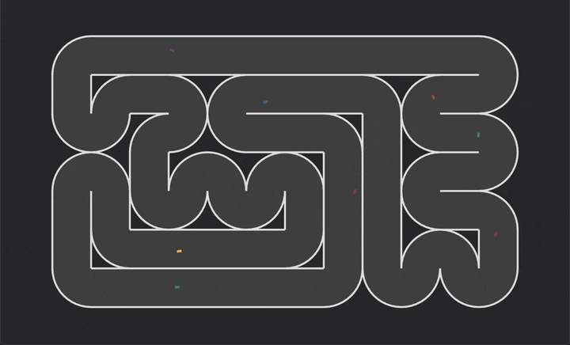
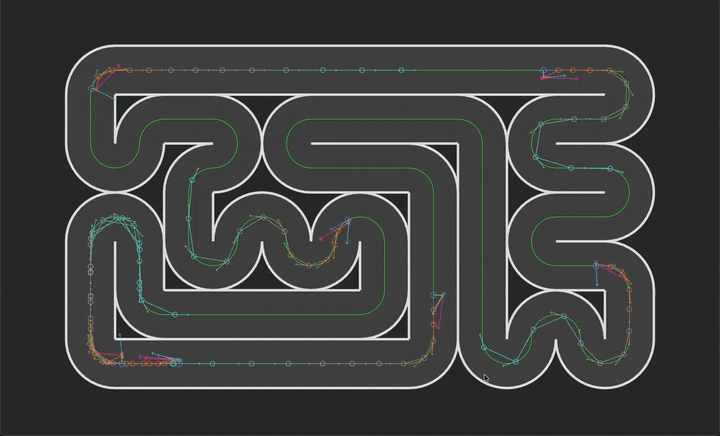
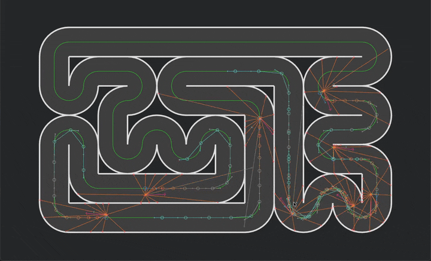

# NeuroDrive: a car learns to drive with a brain that grows, built from first principles in Rust

<p align="center">
  
</p>

A real-time, brain-inspired learning system in Rust and Bevy: cars on a 2D top-down track are driven by a sparse graph of neurons that learns through local plasticity, a dopamine-like reward signal and structural growth and pruning. No backpropagation in the brain, and no ML framework anywhere.

## Overview: one persistent brain, learning while it acts, beside a conventional learner on the same track

### What it is and is not: a learning laboratory, not a benchmark, a game or a framework wrapper

**NeuroDrive** is a focused attempt to answer one question:

> **Can we build a learning system from scratch that mimics how the human brain learns, and watch it gradually acquire driving behaviour in real time?**

The brain is a sparse directed graph of rate-coded neurons. Its connections strengthen and weaken through a three-factor plasticity rule with eligibility traces, homeostatic mechanisms keep it in a healthy operating range, and structural plasticity replaces low-utility neurons, grows new ones when learning plateaus, and prunes and sprouts synapses as it goes. A hand-written PPO actor-critic runs beside it on the same environment as a permanent reference.

It is not:

- a benchmark suite for mainstream reinforcement learning, or a competition between optimisation paradigms;
- a wrapper around PyTorch, TensorFlow, JAX or any other ML library;
- an evolutionary-algorithm playground: there are no generations, no NEAT and no evolution strategies, only one brain learning within its lifetime;
- a racing game with AI glued on top. There is no scoring, progression or player-facing loop, because the audience is engineers watching a learning mechanism, not players.

### Who it is for: engineers who want to see a non-backprop learner tested against a known-good baseline

The reader is an engineer curious whether local, biologically motivated learning rules can control something continuous. That reader needs two things the project is built around: a conventional learner on the same track, because a learning brain is only interesting beside one, and observability deep enough that "looks like learning" is never the evidence.

### Why it exists: the machine-learning playbook is one answer to backprop's failures, not the only one

Standard ML has a well-worn fix for every failure mode: dropout for overfitting, batch norm for instability, experience replay for catastrophic forgetting. That playbook is a specific cultural response to the failure modes of backprop-trained networks. Biology solved the same problems differently, with local learning, neuromodulation, homeostasis and a structure that rewires itself, and NeuroDrive exists to build those mechanisms in an engineered system and watch whether they work.

## Features: a complete environment, two learners and the instruments to tell them apart

### Environment: deterministic, minimal and still hard enough to require learning

- **Deterministic 60 Hz fixed-timestep car physics**, so a run is a function of its inputs and seeds.
- **Steering in `[-1, 1]` and throttle in `[0, 1]`**, with no brake: drag is the only deceleration, so the learner has to plan throttle release in advance.
- **Random spawn positions on every reset**, so no car gets a privileged starting experience and every section of track is learned.
- **Cumulative forward progress along the centreline** as the progress signal, with no finish line or laps that random spawns would make unfair.
- **A multi-car vectorised trainer**: several cars train at once, each with its own state, and the fleet can be all-brain, all-PPO or split side by side.

### Brain-inspired learner: local learning, homeostasis and a graph that changes shape

- **Three-factor plasticity with eligibility traces**: each synapse keeps a short-lived trace of correlated activity, and a global modulator decides which traces become weight changes.
- **Homeostasis**: synaptic scaling bounds each neuron's total input, and an intrinsic-excitability homeostat keeps its firing rate in a target band.
- **Structural plasticity**: neurons are scored on utility, the least useful are replaced, a new neuron grows when reward plateaus, and synapses are pruned and sprouted on a fixed cadence.
- **Ablation switches** for plasticity, homeostasis and structure, so each mechanism's contribution can be measured on its own.

### PPO baseline: a from-scratch reference learner that proves the environment is learnable

- **Clipped-surrogate PPO with an asymmetric actor-critic**, written by hand with no ML library.
- **PopArt critic target normalisation, an observation normaliser and target-KL early stopping**, the interventions that made the critic track real returns.
- **A dual matrix-multiply backend**: Apple Accelerate on macOS, the portable `matrixmultiply` crate elsewhere, and a scalar reference for correctness.

### Observability: every claim about learning is checkable from the run's own record

- **Live overlays and HUD** for geometry, sensors, diagnostics, a per-car leaderboard and the controller layout.
- **A post-run analytics pipeline** with tick-level traces, episode aggregates, crash classification and a Markdown report whose sections adapt to which learners ran.
- **A profiling build** that times every fixed-update system and writes its own report.

## Behaviour: the brain is held to visible learning beside PPO, and the rules forbid shortcuts

### Goals: a brain that learns visibly, measurably and continuously

- The brain-inspired learner drives the track and is seen improving over a long run, measured against PPO on the same track and the same reward.
- Learning is continual: one brain, one lifetime, never reset between episodes.
- Every design decision traces to a biological mechanism, and every new mechanism names the pathology it addresses.

### The biology-first rule: when a problem appears, the answer comes from biology, not the ML toolkit

| Problem | Where the answer comes from |
|---|---|
| Overfitting | Homeostatic plasticity, sparse coding, neuromodulated consolidation |
| Slow learning | Multi-timescale plasticity, attention, neurogenesis |
| Dead neurons or network collapse | Excitatory and inhibitory balance, synaptic homeostasis |
| Catastrophic forgetting | Complementary learning systems, sleep-dependent replay |
| Poor generalisation | Structural plasticity, lateral inhibition |
| Exploration collapse | Noradrenergic arousal, novelty-driven dopamine |

If biology has no clear answer, the next step is more research into the biology, not a shortcut from the ML toolkit.

### Reward: a teaching signal that gates learning, never a brittle objective that makes safe play optimal

The primary constraint is that the simulation is entertaining to watch: cars should drive aggressively and gradually learn to survive.

| Component | Formula | Purpose |
|---|---|---|
| Velocity projection | `dot(velocity, centreline_tangent) / speed_reference × velocity_reward_scale` | Rewards speed along the track direction |
| Centreline proximity | `centreline_reward_coef × (1 − (dist / max_dist)²)` | A gentle shaping signal toward the racing line |
| Crash penalty | `0.0` | Episode termination is already the cost |
| Survival bonus | none | Would make safe, boring play optimal |

When a learner is not learning the right behaviour, the fix is never a penalty or bonus that rewards caution. It is the critic or value predictor, exploration, the observations, or the biology, in that order. The same reward feeds both learners; the brain consumes it as the modulator in its plasticity rule.

### Design decisions behind the environment, and what was tried first

| Decision | Why | What was tried first |
|---|---|---|
| No braking (throttle `[0, 1]`) | Braking creates a safe local optimum where the policy brakes most of the time | `[-1, 1]` throttle; the policy mean converged to -0.60 |
| No finish line or laps | With random spawns a finish line hands easy bonuses to cars spawned near it | Lap detection with a completion bonus |
| Random spawn positions | A fixed spawn gives a privileged starting experience | One car at a canonical start |
| Crash penalty of zero | Any crash penalty teaches the car not to move | A penalty of -5; cars learned to stay still |
| No survival bonus | A per-tick bonus rewards playing safe | Considered and rejected |

### Guarantees and limits: the observation and action contracts are stable; biology is simplified on purpose

The observation is a fixed 43-dimensional vector consumed identically by both learners:

```
Rays (11)                11 normalised raycast distances
Kinematics (3)           v_forward, v_lateral, speed_delta
Centreline (3)           signed offset, heading error, local curvature
Lookahead (24)           12 heading deltas + 12 curvatures (30–650 units, dense-near / sparse-far)
Previous actions (2)     previous_steering, previous_throttle
```



The action is `steering ∈ [-1, 1]` through a full tanh and `throttle ∈ [0, 1]` through `0.5 · (tanh + 1)`, also identical for both learners.

The brain deliberately does less than biology in these places, each a scope choice rather than a gap:

| Simplification | Biological reality | Why it is simplified |
|---|---|---|
| Neurogenesis anywhere | Adult neurogenesis is confined to a few regions | At this scale, with no regions, location carries no meaning |
| A new neuron reuses a dead one's slot | Dead neurons are not replaced in place | Keeps graph bookkeeping simple; framed as death and birth in one step |
| No spatial constraint on new synapses | Axons must physically reach their targets | The graph has no spatial layout to constrain |
| One global modulator broadcast | Neuromodulators project to specific regions | There are no regions to project to yet |
| One learning rule everywhere | Regions use different plasticity rules | Without regions there is nothing to vary across |
| Compressed homeostatic timescales | Synaptic scaling takes about a day | In-game time is compressed by orders of magnitude |
| Random seed wiring | Brains inherit evolved connectivity | Inherited priors would be evolution, which is ruled out |
| Tiny scale | About 86 billion neurons | A few thousand neurons is enough for a 2D track |

## Getting started: a standard Cargo project with no setup beyond Rust

### Requirements: a recent stable Rust toolchain

Rust stable with edition 2024 support. On macOS the Apple Accelerate framework is used automatically and ships with the OS; every other platform uses a portable pure-Rust backend. The project was developed on an 8 GB Apple Silicon laptop with no discrete GPU, so all computation is CPU-bound and fits a 60 Hz frame budget.

### Install and quick start: clone, then run in release mode

```bash
git clone https://github.com/Capataina/NeuroDrive.git
cd NeuroDrive
cargo run --release
```

A window opens on the track with a fleet of cars driving and learning. Release mode matters: a debug build is roughly ten times slower.

### Usage: controls, backends, profiling and tests

| Key | What it toggles |
|---|---|
| F1 | Geometry overlays: centreline, tangents, forward and velocity vectors |
| F2 | Sensor overlays: raycast segments and hit points |
| F3 | Diagnostics HUD and live leaderboard |
| F4 | Cycles the fleet layout: all brain, side by side, all PPO |

All overlays start off. Analytics reports are written under `reports/` when a run exits.



The PPO hot path can be pinned to one matrix-multiply backend, at most one at a time:

| Command | Backend |
|---|---|
| `cargo run --release` | Accelerate on macOS, `matrixmultiply` elsewhere |
| `cargo run --release --no-default-features --features force-accelerate` | Apple Accelerate, macOS only |
| `cargo run --release --no-default-features --features force-matrixmultiply` | `matrixmultiply` on any platform |
| `cargo run --release --no-default-features --features force-scalar` | Naive nested loops, the correctness reference |

`force-accelerate` on a non-macOS platform fails to build by design. The brain does not use matrix multiplication at all: sparse graph traversal gains nothing from it at this scale.

```bash
cargo run --release --features profiling
```

Runs for 30 seconds, exits, and writes a performance report under `reports/performance/`.

## How it works: an ECS simulation with two learners behind one contract

### Architecture: fixed-tick systems feed observations to whichever learner drives each car

```
fixed 60 Hz tick
├─ Input        agent/      read the observation, ask the car's controller for an action
├─ Physics      game/       step car dynamics from the applied action
├─ Collision    game/       corner-based off-track detection
└─ Measurement  game/       progress along the centreline, reward, episode end and reset
                             │
               ┌─────────────┴──────────────┐
          brain/inspired/              brain/ppo/
          sparse graph, local          actor-critic, rollout
          plasticity every tick        buffer, epoch updates
               └─────────────┬──────────────┘
                        analytics/   traces, aggregates, crash forensics, reports
```

Per-car state lives on each car entity, shared state such as a learner's weights is one shared resource, and systems talk through those rather than events. Each car carries a controller marker, so a learner's systems can only ever touch its own cars.

The stack is Rust on Bevy, chosen for a deterministic fixed-timestep ECS and native speed on a CPU-only machine. External ML libraries were ruled out because building the learning from first principles is the point.

### Key concepts: the vocabulary the brain is described in

- **Eligibility trace**: a per-synapse memory of recent correlated activity, so a reward that arrives later can still credit the connection that caused it.
- **Three-factor rule**: a weight changes in proportion to presynaptic activity, postsynaptic activity and a global modulator.
- **Modulator (M)**: the dopamine-like signal gating plasticity; in the current brain it is the raw per-tick reward.
- **Utility**: a running score of how much a neuron contributes, which decides which neurons are replaced.
- **Plateau-triggered neurogenesis**: a new hidden neuron grows when recent episode reward has stopped improving.
- **Layout**: the fleet composition, all brain, all PPO or side by side.

### Invariants: what is always true of the system

- The observation and action contracts are identical for both learners, so any difference in behaviour comes from the learner.
- The brain never uses backpropagation or a global loss; every update uses only information local to the synapse plus the broadcast modulator.
- Depth is fixed and width grows: tanh activations do not allow identity-preserving depth growth, so the graph grows sideways.
- The 43 input and 2 output neurons never move while the hidden graph rewires.
- PPO stays as the permanent baseline and is never retired when the brain improves.

## Project layout: one folder per runtime layer

```
NeuroDrive/
├─ src/
│  ├─ sim/        tick ordering and shared geometry
│  ├─ maps/       the track: tile grid, centreline and arc-length queries
│  ├─ game/       cars, physics, collision, progress, reward and episodes
│  ├─ agent/      observations and actions, the contract both learners share
│  ├─ brain/      the brain-inspired learner, PPO, shared maths and backends
│  ├─ analytics/  run tracking and report exporters
│  ├─ debug/      HUD, overlays and leaderboard
│  └─ profiling/  per-system timing behind the profiling feature
├─ tests/         pipeline tests for both learners and backend correctness
├─ context/       architecture, per-system notes, design decisions and research references
├─ learning/      a study guide to the concepts the project uses
└─ media/         the clips embedded in this README
```

## Development: build and test every backend before a change lands

```bash
cargo test                                                         # default backend
cargo test --no-default-features --features force-scalar           # scalar reference
cargo test --no-default-features --features force-matrixmultiply   # portable backend
cargo test --no-default-features --features force-accelerate       # Accelerate, macOS only
```

Success is every variant green with zero warnings. Hyperparameters belong in the relevant `*Config` struct, never inside a system.

## Direction: a brain that keeps learning while the track changes under it

The long-term aim is a brain that generalises: procedurally generated tracks, obstacles, and tracks that change shape mid-run, which double as the test of whether the learner adapts. Along the way sit a real-time view of the brain growing and pruning, a value predictor learned by plasticity rather than by an oracle, and more neuromodulator channels, each pulled forward only when a measured pathology calls for it. Open work is tracked privately.

## Related work and acknowledgements: the research the design is built on

- Frémaux and Gerstner (2015), *Neuromodulated spike-timing-dependent plasticity, and theory of three-factor learning rules*: the three-factor rule with eligibility traces.
- Dohare et al. (2024, *Nature*), *Loss of plasticity in deep continual learning*: continual backprop's utility-based neuron replacement, adapted here to a graph.
- Tsodyks and Markram (1997) and Foster and Wilson (2006): short-term synaptic dynamics and hippocampal replay, the basis of planned mechanisms.

The research round behind the design is in `context/references/brain-inspired-learning/`.

## License: none declared, so all rights are reserved

The repository has no licence file. Reading the code is welcome; reuse needs the author's permission.
